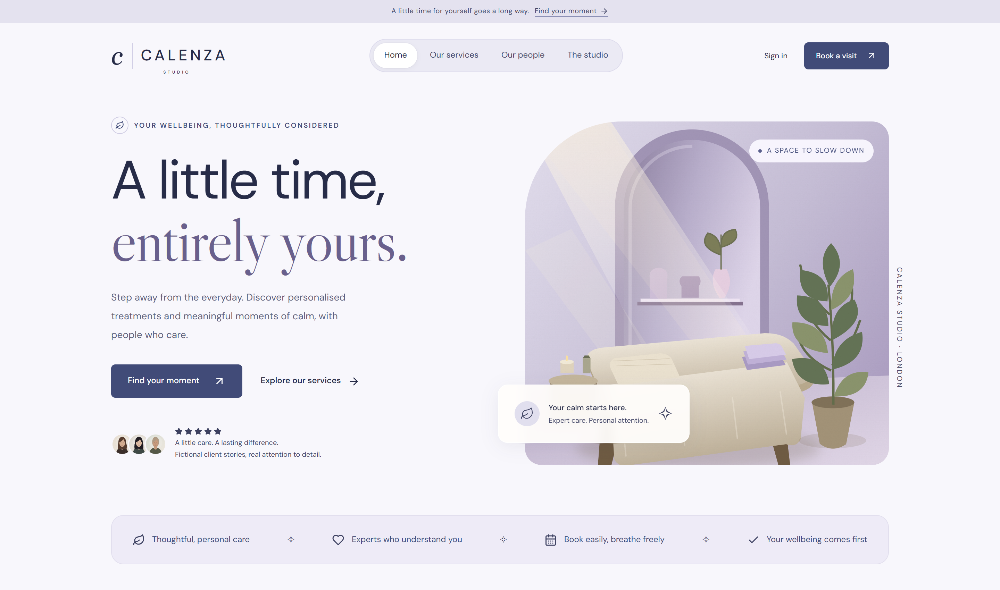
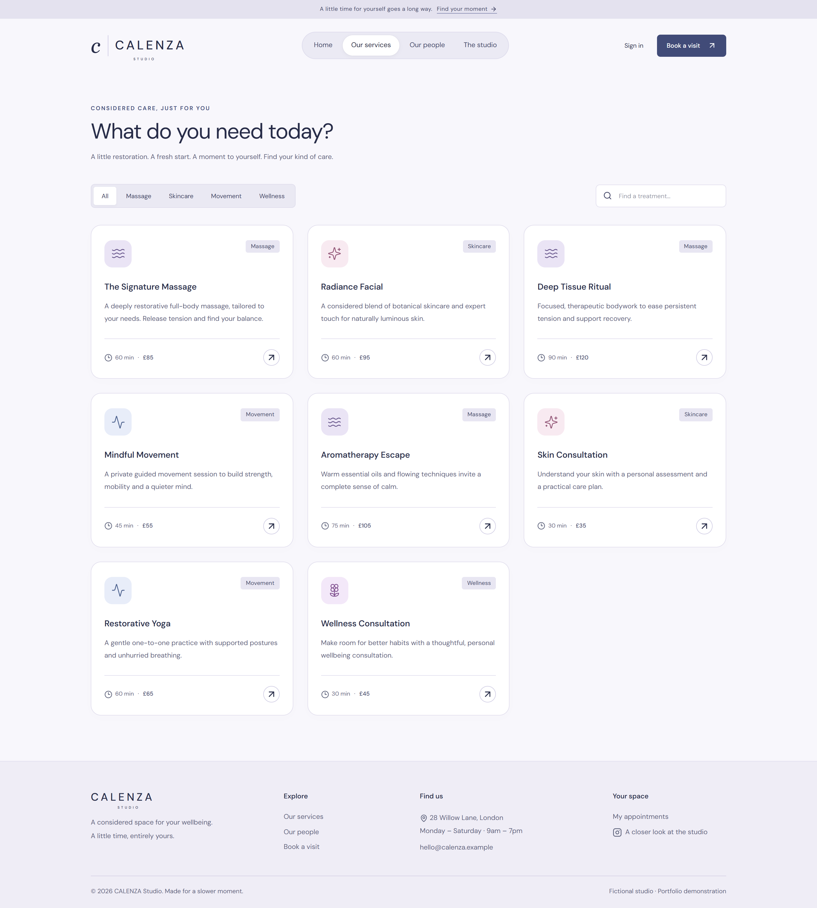
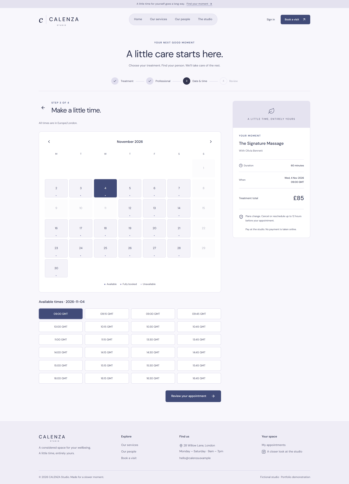
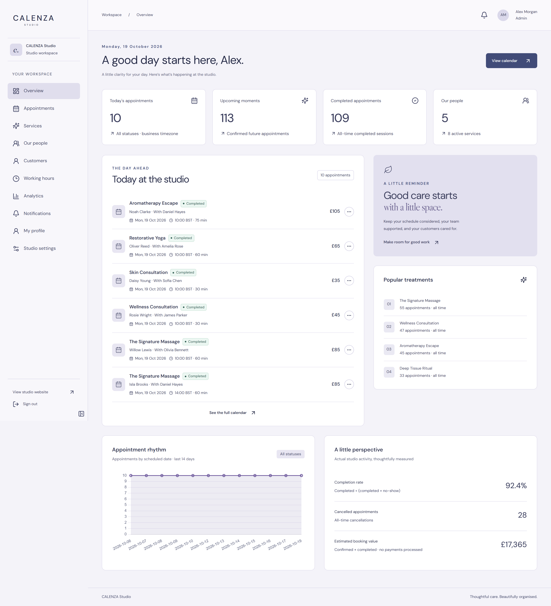
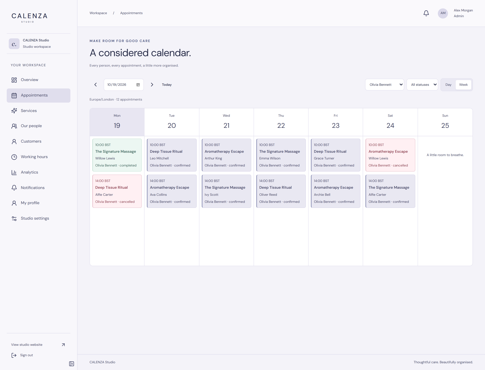
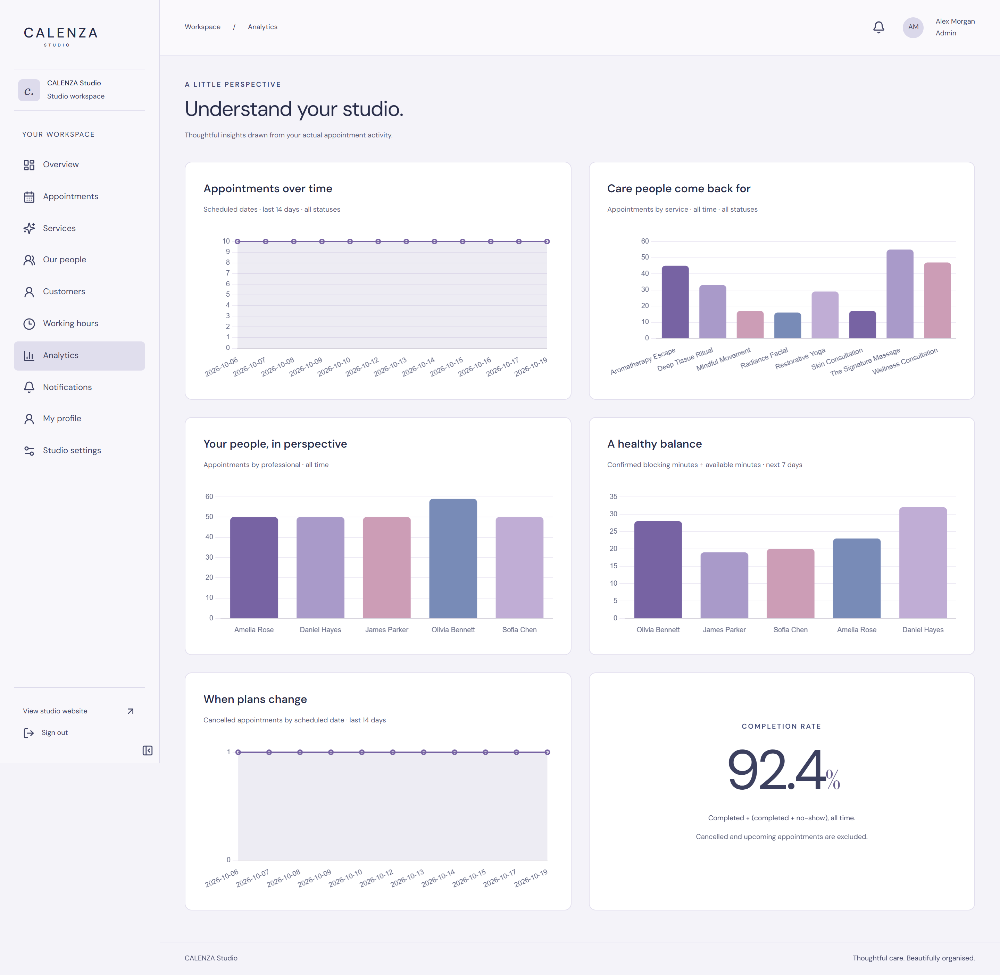

# CALENZA Studio

**Thoughtful care. Effortless scheduling.**

CALENZA brings the calm of a wellness studio to appointment booking. Customers discover treatments and reserve time with the right professional, while the team manages schedules, clients and daily operations in one shared workspace.

[Features](#features) · [Screenshots](#screenshots) · [Quick start](#quick-start) · [Architecture](#architecture) · [Development guide](docs/DEVELOPMENT.md)

## Features

- **A welcoming booking experience** — explore services, meet professionals and choose from live available dates and times.
- **A personal customer space** — manage upcoming visits, reschedule or cancel appointments, update a profile and read notifications.
- **One workspace for the studio** — role-based dashboards, day/week calendars, service and team management, customer history and working-hours editors.
- **Scheduling that respects real availability** — business timezones, daylight-saving transitions, notice periods, buffers, time off and date-specific opening overrides.
- **Reliable booking records** — PostgreSQL prevents overlapping appointments; changes, activity history and notifications commit together. Booked prices and durations survive catalog updates.
- **Useful operational insights** — appointment trends, service demand, staff utilization and estimated booking value from persisted data.

A shared ink-blue, lavender and pearl design system connects the public site, booking flow and management workspace. Layouts adapt to desktop, tablet and mobile, with keyboard-accessible controls and explicit loading, empty and error states.

## Screenshots

Six desktop views of the working application. Select an image to open it at full resolution.

<table>
  <tr>
    <td width="50%" valign="top"><strong>01 · Homepage</strong><br><br><a href="docs/screenshots/desktop-six/01-homepage.png"></a></td>
    <td width="50%" valign="top"><strong>02 · Services</strong><br><br><a href="docs/screenshots/desktop-six/02-services.png"></a></td>
  </tr>
  <tr>
    <td width="50%" valign="top"><strong>03 · Guided booking</strong><br><br><a href="docs/screenshots/desktop-six/03-booking.png"></a></td>
    <td width="50%" valign="top"><strong>04 · Studio dashboard</strong><br><br><a href="docs/screenshots/desktop-six/04-dashboard.png"></a></td>
  </tr>
  <tr>
    <td width="50%" valign="top"><strong>05 · Appointment calendar</strong><br><br><a href="docs/screenshots/desktop-six/05-calendar.png"></a></td>
    <td width="50%" valign="top"><strong>06 · Analytics</strong><br><br><a href="docs/screenshots/desktop-six/06-analytics.png"></a></td>
  </tr>
</table>

Demo people, testimonials and appointments are fictional. Studio and portrait artwork is included locally as SVG illustrations.

## Quick start

Requires **Docker with Compose** and **Python** for the environment helper.

```sh
python scripts/setup_env.py
docker compose up --build
```

Open **[localhost:8080](http://localhost:8080)**. The helper creates random local credentials without overwriting existing configuration. The development stack runs migrations, seeds the demo and persists PostgreSQL data in a named volume.

Prefer a native setup? Use **Python 3.14**, **Node.js 24.15+** and **PostgreSQL 17**, following the [development guide](docs/DEVELOPMENT.md#native-development). The native frontend runs on port 5173 and the API on port 8000.

### Explore the demo

| Experience    | Email                      |
| ------------- | -------------------------- |
| Administrator | `admin@calenza.example`    |
| Professional  | `staff@calenza.example`    |
| Customer      | `customer@calenza.example` |

All three development accounts use **`CalenzaDemo!2026`**. They are created only by the demo seed. The sample studio uses **Europe/London** and **GBP**, with 8 services, 5 professionals and 25 customers.

## Architecture

A single frontend serves public, customer, professional and administrator experiences. The API owns authorization and scheduling rules; PostgreSQL is the source of truth for appointments and availability.

| Layer      | Implementation                                              |
| ---------- | ----------------------------------------------------------- |
| Interface  | Vue 3, strict TypeScript, Vite, Tailwind CSS, Reka UI       |
| State      | Pinia for identity; TanStack Vue Query for server data      |
| API        | FastAPI, Pydantic, SQLAlchemy 2 and asyncpg                 |
| Data       | PostgreSQL 17, Alembic migrations, GiST overlap constraints |
| Contracts  | Generated TypeScript definitions from FastAPI OpenAPI       |
| Validation | Vitest, Playwright, axe-core, pytest and Ruff               |
| Delivery   | Docker Compose, Nginx and GitHub Actions workflow           |

```text
apps/web/              Vue application, shared UI and feature modules
apps/api/              API, scheduling engine, migrations and backend tests
tests/e2e/             Browser workflows and accessibility checks
infrastructure/nginx/  SPA hosting and same-origin API proxy
docs/                  Development guide, validation report and screenshots
```

Authentication uses Argon2 password hashes, HttpOnly session cookies, rotating refresh sessions, CSRF protection and backend role/ownership checks. Appointment times are stored as timezone-aware instants; recurring working hours follow the studio's local timezone.

## Development and validation

```sh
npm ci
npm run lint
npm run build
npm test
```

Backend integration tests use a separate PostgreSQL database. Browser tests require the running API, frontend and demo data. See the [complete test commands](docs/DEVELOPMENT.md#verification), [validation report](docs/DELIVERY.md) and [source inventory](docs/FILE_TREE.txt).

## Scope

CALENZA is a working single-studio portfolio application. Email is recorded in a development outbox; SMTP delivery, scheduled reminders, payments and multi-tenancy are outside this version. The calendar supports day/week browsing and appointment actions, without drag-and-drop scheduling.

Native execution has been verified. Docker/Nginx runtime and remote GitHub Actions execution remain unverified on the development host. Public deployment also requires HTTPS, secure cookies and deployment-specific operational configuration; see the [security notes](docs/DEVELOPMENT.md#authentication-and-security).
